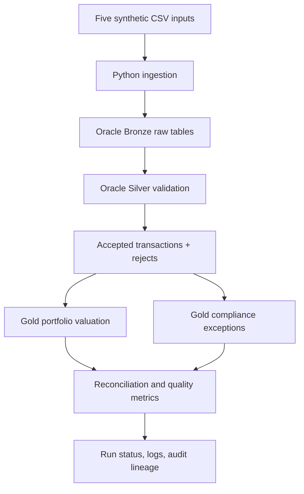

# Asset Management Data Pipeline

A small Oracle SQL + Python prototype for the Asset Management Data Pipeline case study.

It demonstrates:
- Bronze/raw ingestion of five synthetic source datasets
- Silver validation and rejection reasons
- Gold portfolio valuation and restricted-security exceptions
- Dataset-aware, business-date-aware duplicate-delivery fingerprinting
- Transaction idempotency, versioned corrections, and conflicting duplicate quarantine
- Effective-dated Security Master versions and overlap detection
- Conflicting reference-data duplicate detection (no arbitrary ROW_NUMBER winner)
- Deterministic market-price source tie-breaking
- Run-level record reconciliation and run-scoped Gold outputs
- Atomic published-run pointer updated only with successful completion
- Failure injection after Bronze, transaction validation, and Gold build
- Synthetic volume generation and simple performance measurements

> **Scope:** This is an interview/case-study prototype, not a production investment or regulatory reporting system. It uses synthetic data only. Review every assumption and be prepared to explain it.

## Architecture



Layers:
- **Bronze:** raw source rows and delivery metadata.
- **Silver:** accepted transactions plus transaction and reference-data rejection records.
- **Gold:** portfolio valuation, missing/stale/security/currency exceptions, and restricted-trade exceptions.
- **Operations:** run status, per-dataset counts, source lineage, delivery-attempt history, error details and elapsed time.

## Repository layout

```text
asset_management_data_pipeline/
├── README.md
├── requirements.txt
├── .env.example
├── .gitignore
├── sql/
│   ├── 01_schema.sql
│   ├── 02_seed_reference_data.sql
│   ├── 03_process_run.sql
│   └── 04_demo_queries.sql
├── src/
│   ├── __init__.py
│   ├── pipeline.py
│   ├── pipeline_common.py
│   ├── reference_loader.py
│   ├── transaction_processor.py
│   ├── gold_processor.py
│   └── generate_data.py
├── data/
│   ├── security_master.csv
│   ├── transactions.csv
│   ├── positions.csv
│   ├── market_prices.csv
│   └── restricted_securities.csv
├── tests/
│   ├── test_data_quality.py
│   ├── test_transaction_logic.py
│   └── test_sql_contracts.py
└── docs/
    └── engineering_decisions.md
```

## Python code organization

The pipeline is split by responsibility to keep each module focused without introducing unnecessary class layers:

- `pipeline.py` — command-line entry point and end-to-end orchestration.
- `pipeline_common.py` — shared configuration, Oracle connection, CSV parsing, hashing and common helpers.
- `reference_loader.py` — Bronze ingestion, reference-data validation and curated reference merges.
- `transaction_processor.py` — transaction validation, versioned corrections and canonical transaction processing.
- `gold_processor.py` — reconciliation persistence and Gold calculations.

The existing command remains unchanged: `python -m src.pipeline --business-date YYYY-MM-DD`.

## Requirements

- Python 3.10+
- Oracle Database 19c+ (or compatible Oracle instance)
- Oracle account with permission to create tables and execute the included SQL
- Python packages listed in `requirements.txt`

## Setup

### 1. Create a virtual environment

Windows PowerShell:

```powershell
py -m venv .venv
.venv\Scripts\Activate.ps1
pip install -r requirements.txt
```

macOS/Linux:

```bash
python3 -m venv .venv
source .venv/bin/activate
pip install -r requirements.txt
```

### 2. Configure credentials

Copy `.env.example` to `.env` and set your Oracle connection details. Do not commit `.env`.

```text
DB_USER=your_user
DB_PASSWORD=your_password
DB_DSN=localhost:1521/FREEPDB1
```

The sample Python program reads environment variables. Load them into your shell before running, or use a local environment loader of your choice.

PowerShell example:

```powershell
$env:DB_USER="your_user"
$env:DB_PASSWORD="your_password"
$env:DB_DSN="localhost:1521/FREEPDB1"
```

### 3. Create schema

Connect to Oracle using SQL Developer or SQLcl and execute in order:

1. `sql/01_schema.sql`
2. `sql/02_seed_reference_data.sql`

The scripts create the empty business/output tables; the Python pipeline loads the synthetic CSV inputs. This schema has changed to support effective-dated securities, transaction versions, reconciliation, and publication pointers. Use a fresh assessment schema or apply a separately reviewed migration to an existing database; do not rerun the CREATE TABLE script over an existing schema. If using SQL Developer, run each script as a script (F5).

### 4. Run the pipeline

```bash
python -m src.pipeline --business-date 2026-10-29
```

Optional flags:

```bash
python -m src.pipeline --business-date 2026-10-29 --fail-after-load
python -m src.pipeline --business-date 2026-10-29 --force-replay
python -m src.pipeline --business-date 2026-10-29 --fail-after-stage after_transactions
python -m src.pipeline --business-date 2026-10-29 --fail-after-stage after_gold
python -m src.pipeline --business-date 2026-10-29 --log-level DEBUG
```

- `--fail-after-load` is retained as a backward-compatible failure injection after Bronze load.
- `--fail-after-stage` supports `after_load`, `after_transactions`, and `after_gold`; the latter two fail before publication. Re-run without injection to demonstrate replay.
- `--force-replay` skips the delivery short circuit but still relies on transaction business keys to avoid duplicate accepted transactions. Each forced replay is retained in `FILE_DELIVERY_ATTEMPTS`. Use only for demonstration.
- `--log-level` supports DEBUG, INFO, WARNING, and ERROR. Set `LOG_LEVEL` in the environment to configure default logging.

### 5. Inspect outputs

Execute `sql/04_demo_queries.sql`. Downstream consumers should resolve the run for a business date through `GOLD_PUBLISHED_RUNS` and then read only rows for that `RUN_ID`. Do not read arbitrary in-progress run IDs. The Gold tables include:
- `GOLD_PORTFOLIO_POSITIONS`
- `GOLD_DATA_QUALITY_EXCEPTIONS`
- `GOLD_COMPLIANCE_EXCEPTIONS`
- `PIPELINE_RUNS`
- `PIPELINE_RECONCILIATION`
- `REFERENCE_DATA_REJECTS`
- `TRANSACTION_REJECTS`
- `FILE_DELIVERY_ATTEMPTS`

## Running tests

```bash
python -m unittest discover -s tests -v
# pytest is also supported when installed:
python -m pytest -q
```

The SQL contract tests inspect generated Oracle SQL and ensure expected validation branches are present. They do not replace running the scripts against a live Oracle instance.

## Test scenarios

1. **Successful run:** run the pipeline once and inspect output tables.
2. **Duplicate delivery:** run again with identical input; the delivery hash check skips the already-successful delivery.
3. **Transaction duplicate:** change a CSV to repeat a transaction ID; validation retains one identical record and quarantines conflicting versions.
4. **Missing price:** the S103 position has no price and appears in `GOLD_DATA_QUALITY_EXCEPTIONS`; it is not silently valued at zero.
5. **Restricted security:** T1002 is a trade in S102 while a restriction is active; inspect compliance output.
6. **Controlled failure and replay:** run with `--fail-after-load`, then rerun without it. Check run statuses and final counts.
7. **Volume:** use `python -m src.generate_data --rows 10000 --output data/transactions_large.csv`, then point the transaction path in your local run configuration to the generated file and compare elapsed time. Do not treat synthetic timing as a production benchmark.

## Business assumptions

- All data is synthetic.
- Optional transaction correction columns are `record_version` (default 1), `supersedes_version`, and `correction_reason`. Example: a correction to version 1 supplies `record_version=2`, `supersedes_version=1`, and a non-empty correction reason.
- Quantities are signed: positive = buy/increase; negative = sell/decrease.
- Position rows are opening snapshots. Only transactions after the selected snapshot date and on/before the business date are applied.
- Market prices must be on or before the business date and no more than 3 calendar days old.
- This prototype assumes position, transaction and market price currencies are compatible; no FX conversion is implemented.
- A missing or stale price creates a Gold data-quality exception and withholds that valuation row.
- A restriction is applicable when status is `ACTIVE` and trade date is within the inclusive effective interval.
- Transaction rows support optional `record_version`, `supersedes_version`, and `correction_reason` columns. Omitted `record_version` defaults to 1. A correction must use the next consecutive version, identify the currently active version it supersedes, and provide a reason. Prior versions are retained as `SUPERSEDED`; downstream positions and compliance use only `CURRENT`. Same-version conflicting payloads and stale/invalid corrections are quarantined.
- Delivery fingerprint includes business date, schema version, dataset identity, file name and each file content hash.
- Security Master rows are versioned by `(SECURITY_ID, EFFECTIVE_FROM)`; overlapping intervals are rejected.
- Price source precedence is deterministic: PRIMARY, BLOOMBERG, REUTERS, then other sources; business owners must approve this illustrative ordering.
- Business date is passed explicitly, avoiding dependence on the machine's local clock.

## Security notes

- Never commit credentials or real client data.
- Use a least-privilege Oracle account.
- Use TLS/wallet settings appropriate to your Oracle environment.
- In production, rotate secrets, restrict logs, and apply retention/access policies.
- Add database grants, encryption, secret management and audit policies before production use.

## Implemented hardening in this revision

- Delivery identity is deterministic and includes business date plus dataset-specific file identity/content hashes.
- Invalid transaction dates are rejected rather than crashing the date parser. Duplicate CSV headers are rejected.
- Conflicting duplicate reference keys fail the delivery rather than silently selecting an arbitrary row. Exact duplicate reference rows are collapsed and counted in reconciliation.
- Transactions support explicit versioned corrections; prior versions are retained, and only the current version contributes to positions/compliance. Replaying a previously seen version is counted as a duplicate.
- Security Master supports multiple effective-dated rows per security, permits controlled closure of an open interval when the next version starts the following day, and rejects overlaps across existing and incoming history.
- Transaction-only portfolio/security combinations are included in position balances even when no opening snapshot exists.
- Latest price selection has deterministic source tie-breaking.
- `PIPELINE_RECONCILIATION` records mutually exclusive received/accepted/rejected/duplicate counts for all five input datasets. `PIPELINE_RUNS` totals include all datasets, not only transactions.
- `FILE_DELIVERY_ATTEMPTS` preserves duplicate skips, failed attempts, successful attempts and explicit forced replays without losing prior attempt lineage.
- Transaction processing caches effective-dated Security Master history and prefetches existing transaction versions in bounded batches to avoid per-row lookup queries.
- Gold exception generation explicitly identifies missing/inactive Security Master records, missing/null/invalid/stale prices and position/transaction currency inconsistencies. Overlapping restriction intervals are rejected before merge.
- Decimal parsing rejects NaN and Infinity; transaction hashes use canonical JSON and normalized decimal representations.
- `GOLD_PUBLISHED_RUNS` is the consumer-facing pointer. It is switched in the same database commit as the successful run status.
- Failure injection can occur after Bronze, transaction validation, or Gold calculation before publication.
- Unit tests cover parsers, date-aware delivery fingerprints, CSV contracts, file hashing, canonical transaction hashes, correction-version transitions, effective-dated currency lookup, transaction processing and generated SQL contracts. Logging includes run IDs and stage/count events.

## Explicitly out of scope for this requested revision

- Concurrent-run protection / database claim locks (intentionally not implemented). Do not run overlapping executions for the same business date/delivery.
- The upstream must guarantee that transaction versions are authoritative and monotonically increasing; correction/reversal accounting semantics and historical restatement policy still require business sign-off.
- FX conversion, corporate actions, settlement logic, accrued interest, lot accounting, and regulatory sign-off.
- Full Oracle integration tests and performance benchmarking; unit tests do not replace execution against a configured Oracle instance. The SQL DDL and DML must be applied and exercised against the target Oracle version before operational use.
- Full schema evolution framework, dashboards/alerting, and distributed orchestration.
